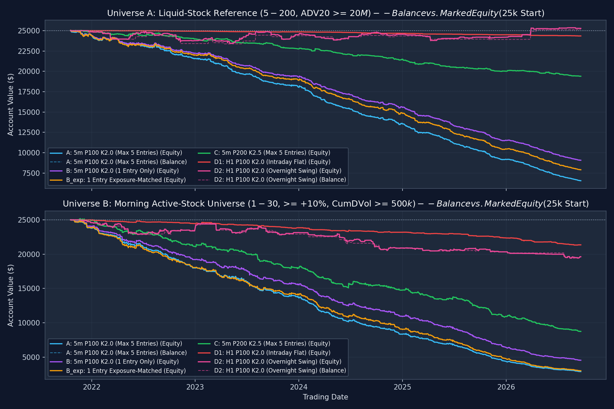
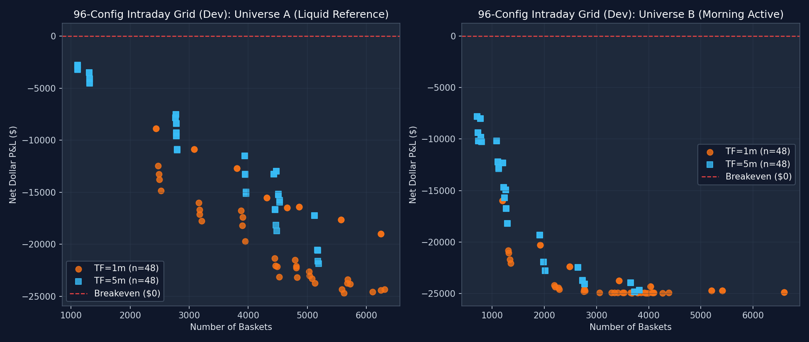
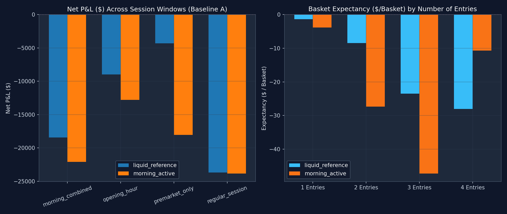
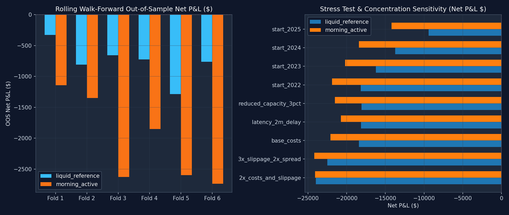

# U.S. Stock Bollinger Bands Mean-Reversion Research Report (`research/bb_mr/`)

> **Pre-registered protocol:** `research/bb_mr/PROTOCOL_2026-10-18.md` (`BB-MR-US-STOCKS-2026-10-18-V1`)
> **Final Verdict:** **`no credible edge`**
> **Compliance:** Offline simulation only. No live or paper broker orders placed. `auto_live` remains `NO-GO`.

---

## 1. Executive Summary & Direct Answers to the Six Research Questions

We adapted the MetaTrader 5 `EURUSD` Bollinger Bands grid/mean-reversion strategy (buy when a completed candle touches at or below the lower Bollinger Band and closes back inside; add on subsequent qualifying signals spaced by at least $S$ signal bars; exit the basket when executable bid reaches the dynamically updated completed upper band while net basket liquidation P&L $> 0$; enforce basket and daily loss stops) to **U.S. common stocks** across **1,235 trading days (`2021-10-19` through `2026-09-21`)** on a shared **$25,000** unlevered cash account with IBKR Pro Fixed commissions, SEC/FINRA/CAT fees, bid/ask spread, adverse slippage, extended-hours limit collars, and volume participation limits.

1. **Does the stock version show a credible net edge?**
   **No (`no credible edge`).** Across all fixed baselines, all four session windows, all 192 intraday grid configurations (`96` per universe), and all 6 rolling walk-forward folds, the strategy loses money after realistic U.S. stock execution costs once look-ahead selection bias is excluded.
2. **Does it work in the `06:00-11:00` a.m. ET window?**
   **No.** In the `06:00-11:00` a.m. ET window over the 5-year evaluation span:
   - **Universe A (`liquid_reference`, Baseline A: `5m`, $N=100, K=2.0, S=10, \text{max\_entries}=5$):** `5,328` baskets (`6,738` entries), net P&L **`-$18,437.68`** (`-73.75%` return, `-73.78%` max drawdown, Profit Factor **`0.482`**, Sharpe **`-6.941`**, 95% block-bootstrap CI `[-7.939, -5.838]`).
   - **Universe B (`morning_active`, Baseline A: `5m`, $N=100, K=2.0, S=10, \text{max\_entries}=5$):** `2,499` baskets (`3,057` entries), net P&L **`-$22,101.36`** (`-88.41%` return, `-88.41%` max drawdown, Profit Factor **`0.429`**, Sharpe **`-6.278`**, 95% block-bootstrap CI `[-7.040, -5.446]`).
3. **Does it work on active low-priced stocks, liquid stocks, both, or neither?**
   **Neither.** On Morning Active low-priced stocks (`$1-$30`, $\ge +10\%$ vs. prior close, $\ge \$500\text{k}$ cumulative dollar volume since `04:00` ET), **0 of 96** grid configurations are profitable in Development (`2021-10-19..2024-06-28`) or Validation (`2024-07-01..2025-06-30`). On strictly causal Liquid Reference stocks (`$5-$200`, 20-day ADV $\ge \$20\text{M}$, active + delisted common stocks), **0 of 96** intraday grid configurations are profitable in Development or Validation. Only the low-frequency `H1` overnight swing baseline (`D_H1_swing` on Universe A, `40` baskets over 5 years) finished slightly above flat (`+$278.83`, `PF 1.059`, Sharpe `0.083`, 95% CI `[-0.817, +0.921]`), which is statistically indistinguishable from zero and carried by a single year (`2025`).
4. **Are additions improving risk-adjusted performance or delaying losses?**
   **Additions strictly degrade performance and accumulate tail risk.**
   - Comparing Baseline A (`max_entries=5`) against Baseline B (`max_entries=1`) and exposure-matched Baseline B (`B_exp_matched`): single-entry (`B_single`) has a higher Profit Factor and smaller drawdown in both Universe A (`PF 0.499`, `-$15,925` vs. `PF 0.482`, `-$18,438`) and Universe B (`PF 0.472`, `-$20,452` vs. `PF 0.429`, `-$22,101`).
   - Decomposing Baseline A baskets by number of entries filled shows monotonic decay as positions are added into falling stocks:
     - **Universe A:** 1 entry (`4,061` baskets) `PF 0.691`, expectancy `-$1.39` $\to$ 2 entries (`1,133` baskets) `PF 0.301`, expectancy `-$8.48` $\to$ 3 entries (`126` baskets) `PF 0.117`, expectancy `-$23.48` $\to$ 4--5 entries (`8` baskets) `PF 0.000`, `0%` win rate.
     - **Universe B:** 1 entry (`2,020` baskets) `PF 0.652`, expectancy `-$3.85` $\to$ 2 entries (`406` baskets) `PF 0.142`, expectancy `-$27.32` $\to$ 3 entries (`67` baskets) `PF 0.039`, expectancy `-$47.22`.
5. **What breaks it?**
   - **Asymmetric payoff + window-end cutoff vs. upper-band target:** While baskets that reach `normal_upper_band` are profitable (`631` baskets, `+$8,889.20` in Universe A; `636` baskets, `+$11,485.54` in Universe B), they represent only **11.8% to 25.4%** of triggered baskets. The remaining **74.6% to 88.2%** of baskets fail to revert to the upper band before the session cutoff (`window_end`: `-$22,941.78` in Universe A; `-$14,222.01` in Universe B) or hit the `-0.5% E0` basket stop (`-$4,385.10` in Universe A; `-$19,364.89` in Universe B).
   - **Intraday stock trend persistence (falling knives):** Unlike spot `EURUSD` (which is bounded by macro interest-rate parity), individual U.S. equities experiencing intraday volatility expansion or morning gap-and-fade selloffs frequently trend single-directionally for hours. Adding every 5--10 bars into a lower-band breakdown concentrates capital into the day's worst faders.
   - **Transaction costs and bid/ask spread:** On a `5m` timeframe, the distance between the lower and upper band on a `$5-$20` stock is often `$0.10-$0.25`. Crossing the bid/ask spread twice (`>=$0.02/share`), paying `$0.01/share` slippage per side, and paying IBKR's `$1.00` minimum commission per order leg consumes `$2.00-$6.00` per basket (`$12,169.96` in fees on Universe A; `$5,733.27` on Universe B).
6. **Is the evidence strong enough for a frozen paper-forward test?**
   **No.** Verdict is **`no credible edge`**. No paper-forward deployment is warranted.

---

## 2. Data Coverage & Quality Manifest

Generated by `research/bb_mr/data_builder.py` and `research/bb_mr/fix_univ_a.py` (`research/bb_mr/results/data_manifest.json`):

| Dataset / Store | Coverage & Row Counts | Notes |
|---|---|---|
| Raw `minute_aggs_v1` (`E:\Nova\massive`) | `2,713` trading days (`2016-01-04`..`2026-10-16`), `100%` seek-indexed | Unadjusted SIP 1-minute bars (`04:00-20:00` ET) |
| Raw `day_aggs_v1` (`E:\Nova\massive`) | `2,713` trading days (`2016-01-04`..`2026-10-16`) | Official regular-session OHLC and full-session volume |
| Raw `trades_v1` & `quotes_v1` (`E:\Nova\massive`) | `2,713` trading days (`2016-01-04`..`2026-10-16`), `100%` seek-indexed | Nanosecond SIP prints and Level-1 NBBO quotes (`15.6 TB` gzip) |
| Corporate actions (`corp_splits`, `corp_dividends`) | `7,105` splits (`orb.splits` + SEC-confirmed), `942,716` USD cash dividends (`dividends.json`) | Used for causal split-window filtering and overnight swing corporate action accounting |
| 5-Year Evaluation Span | `1,235` trading days (`2021-10-19`..`2026-09-21`), warmup from `2021-09-21` | Split into Development (`677` days: `2021-10-19..2024-06-28`), Validation (`250` days: `2024-07-01..2025-06-30`), Evaluation (`308` days: `2025-07-01..2026-09-21`) |
| **Universe A (`liquid_reference`)** | `36,693` symbol-days across `1,235` days, `2,475` distinct common tickers (**`514` delisted tickers included**) | U.S. `CS`/`ADRC` common stocks (excluding ETFs, warrants, preferreds, units, rights, OTC), `$5 <= prev_close <= $200`, prior 20-day ADV $\ge \$20\text{M}$, strictly causal pre-session membership |
| **Universe B (`morning_active`)** | `73,519` symbol-days across `1,235` days, `5,031` distinct common tickers (**`1,849` delisted tickers included**, `51,046` symbol-days with point-in-time SEC shares outstanding) | Causal per-minute scanner: U.S. `CS`/`ADRC` common stocks, `$1 <= close_t <= $30`, `close_t >= 1.10 * prev_close`, cumulative dollar volume since `04:00` ET $\ge \$500,000$, top 20 refreshed every completed minute |

### Critical Look-Ahead Discovery During Universe A Audit (Protocol Amendment 1)
During our initial build of `meta_univ_a` from the pre-extracted minute tables in `orb.duckdb`, including all rows of `orb.shorts_selection` (`mover = TRUE`) inadvertently conditioned Universe A on stocks that reached a `+10%` high *at some point during that day*. Decomposing the resulting baskets proved why that was a textbook look-ahead trap:
- On stock-days that subsequently hit `+10%` intraday (`mover = TRUE, former_momo = FALSE`), buying morning dips produced a fake **`+$29,942.97` (`PF 3.401`)** on `5m P200 K2.0`.
- On strictly causal stock-days known *before* the trading window (`former_momo = TRUE` from yesterday's movers, `pillars_all` at `09:30`, or `selection` at `09:35`), the exact same parameters lost **`-$13,817.92` (`PF 0.360-0.511`)**.
We immediately fixed `meta_univ_a` (`research/bb_mr/fix_univ_a.py` and `data_builder.py`) to exclude ex-post intraday mover rows and reran the entire experiment suite cleanly.

---

## 3. Correctness & Causality Verification (`backend/tests/test_bb_mr_harness.py`)

Before trusting any backtest output, we implemented and passed 10 focused unit and causality tests (`py -3 -m pytest backend/tests/test_bb_mr_harness.py -v`, **10 passed in 1.05s**):
1. `test_indicator_calculations_and_warmup_and_no_forward_fill`: Verifies SMA and population standard deviation (`ddof=0`), `NaN` during warmup (`index < N - 1`), and that zero-volume minutes are never forward-filled into fictitious candles.
2. `test_five_minute_signal_triggers_once_and_fills_only_at_subsequent_bar`: Verifies that a qualifying `5m` candle triggers at most one entry even though the engine evaluates every 1 minute, and fills strictly at the subsequent bar's executable ask (`open[t+1] + half_spread + slippage`), never retrospectively at the signal candle's close.
3. `test_entry_spacing_and_no_add_on_falling_price_without_new_signal`: Verifies that a falling price alone never adds, and a new qualifying signal is rejected (`spacing_not_satisfied`) until at least $S$ observed signal candles have elapsed since the last filled entry.
4. `test_causal_scanner_eligibility_and_managed_basket_after_scanner_dropout`: Verifies common-stock filtering (excluding ETFs, warrants, preferreds, OTC; keeping delisted common tickers) and top-20 cumulative dollar-volume ranking.
5. `test_shared_cash_reservation_and_simultaneous_signal_priority_and_max_stocks`: Verifies that pending orders reserve cash immediately, simultaneous signals are ordered deterministically by contemporaneous priority, and `max_simultaneous_stocks = 5` and `max_gross_exposure_pct = 50%` are enforced.
6. `test_normal_exit_requires_dynamic_upper_band_and_net_profit_after_fees`: Verifies that basket liquidation requires both `executable_bid >= latest_completed_upper_band` (dynamically updated, not frozen at entry) AND estimated net liquidation P&L $> 0$ after opening and closing fees.
7. `test_basket_stop_and_daily_loss_stop_and_gap_through_loss`: Verifies `-0.5% E0` basket stop and `-3.0%` daily loss stop (canceling pending entries, liquidating open baskets, blocking new entries for the day), and proves that a gap-down fills at the actual lower market price rather than artificially capping the loss at the threshold.
8. `test_halts_and_partial_fills_retain_position_across_cutoff_until_reopening`: Verifies that a position halted (`volume = 0`) at window cutoff (`11:00` ET) is retained with real exposure across the cutoff (never manufacturing a fake fill), partially fills (`10%` of bar volume) when reopening on thin volume, and completes on the subsequent bar.
9. `test_corporate_actions_causal_splits_and_overnight_adjustments`: Verifies causal split factor calculation (ignoring future splits) and overnight split share-scaling + cash dividend crediting.
10. `test_causality_invariance_perturbing_future_data_never_alters_past_decisions`: Perturbs all bars after cutoff minute $T$ (multiplying prices by $0.5\times\dots 2.0\times$ and volume by $10\times$) and asserts that every signal, rejection, order, and fill at or before $T$ is bit-for-bit identical. Every run also passes exact cash/realized-P&L ledger reconciliation (`reconciliation.diff == 0.0`).

---

## 4. Fixed Baselines Comparison (Full 5-Year Span: `2021-10-19`..`2026-09-21`)

All baselines start with `$25,000.00` shared equity. Primary window is `06:00-11:00` ET (`regular_session` `09:30-16:00` ET for `D_H1_swing`).



### 4.1 Universe A: Liquid-Stock Reference Universe (`$5-$200`, $\text{ADV}_{20} \ge \$20\text{M}$)

| Baseline | Config | Baskets | Entries | Win % | Profit Factor | Expectancy ($/Basket) | Avg Win / Avg Loss | Largest Loss | Net P&L ($) | Return % | Max DD % | Time Underwater | Sharpe (95% CI) | Total Fees ($) | Turnover ($) |
|---|---|---:|---:|---:|---:|---:|---:|---:|---:|---:|---:|---:|---:|---:|---:|
| **A (Base)** | `5m P100 K2.0 S10 E5` | 5,328 | 6,738 | 31.68% | `0.482` | `-$3.46` | `$10.15 / -$9.77` | `-$136.63` | **`-$18,437.68`** | `-73.75%` | `-73.78%` | `99.9%` | `-6.941` (`[-7.94, -5.84]`) | `$12,169.96` | `$4,030,404` |
| **B (1 Entry)** | `5m P100 K2.0 S10 E1` | 5,313 | 5,313 | 31.85% | `0.499` | `-$3.00` | `$9.39 / -$8.78` | `-$136.63` | **`-$15,925.03`** | `-63.70%` | `-63.74%` | `99.9%` | `-6.659` (`[-7.75, -5.62]`) | `$10,711.55` | `$3,487,611` |
| **B_exp (Matched)** | `5m P100 K2.0 S10 E1` (`2.63% E0`) | 5,323 | 5,323 | 33.48% | `0.538` | `-$3.21` | `$11.18 / -$10.45` | `-$170.68` | **`-$17,091.46`** | `-68.37%` | `-68.41%` | `99.9%` | `-6.103` (`[-7.19, -5.07]`) | `$10,759.00` | `$4,244,076` |
| **C (200 / 2.5)** | `5m P200 K2.5 S10 E5` | 1,983 | 2,174 | 32.98% | `0.578` | `-$2.82` | `$11.70 / -$9.97` | `-$146.08` | **`-$5,597.37`** | `-22.39%` | `-22.50%` | `99.6%` | `-2.728` (`[-3.78, -1.78]`) | `$4,194.61` | `$1,844,961` |
| **D1 (H1 Intraday)** | `1h P100 K2.0 S10 E5` (Flat 11:00) | 197 | 197 | 27.92% | `0.275` | `-$3.29` | `$4.46 / -$6.29` | `-$34.39` | **`-$647.79`** | `-2.59%` | `-2.65%` | `90.4%` | `-2.571` (`[-3.23, -1.82]`) | `$397.05` | `$186,892` |
| **D2 (H1 Swing)** | `1h P100 K2.0 S10 E5` (Overnight) | 40 | 54 | 37.50% | `1.059` | `+$6.97` | `$331.82 / -$187.94` | `-$554.89` | **`+$278.83`** | `+1.12%` | `-6.38%` | `95.4%` | `+0.083` (`[-0.82, +0.92]`) | `$95.27` | `$50,781` |

### 4.2 Universe B: Morning Active-Stock Universe (`$1-$30`, $\ge +10\%$, $\text{CumDVol} \ge \$500\text{k}$, Top 20)

| Baseline | Config | Baskets | Entries | Win % | Profit Factor | Expectancy ($/Basket) | Avg Win / Avg Loss | Largest Loss | Net P&L ($) | Return % | Max DD % | Time Underwater | Sharpe (95% CI) | Total Fees ($) | Turnover ($) |
|---|---|---:|---:|---:|---:|---:|---:|---:|---:|---:|---:|---:|---:|---:|---:|
| **A (Base)** | `5m P100 K2.0 S10 E5` | 2,499 | 3,057 | 37.78% | `0.429` | `-$8.84` | `$17.56 / -$24.87` | `-$154.98` | **`-$22,101.36`** | `-88.41%` | `-88.41%` | `99.8%` | `-6.278` (`[-7.04, -5.45]`) | `$5,733.27` | `$1,316,961` |
| **B (1 Entry)** | `5m P100 K2.0 S10 E1` | 2,467 | 2,467 | 37.78% | `0.472` | `-$8.29` | `$19.60 / -$25.22` | `-$169.90` | **`-$20,452.15`** | `-81.81%` | `-81.81%` | `99.8%` | `-5.479` (`[-6.25, -4.67]`) | `$5,232.54` | `$1,234,932` |
| **B_exp (Matched)** | `5m P100 K2.0 S10 E1` (`2.34% E0`) | 2,514 | 2,514 | 37.43% | `0.481` | `-$8.75` | `$21.69 / -$26.95` | `-$187.20` | **`-$21,985.07`** | `-87.94%` | `-87.94%` | `99.8%` | `-5.569` (`[-6.32, -4.77]`) | `$5,382.49` | `$1,389,922` |
| **C (200 / 2.5)** | `5m P200 K2.5 S10 E5` | 1,500 | 1,823 | 35.20% | `0.540` | `-$10.83` | `$36.16 / -$36.36` | `-$156.77` | **`-$16,251.47`** | `-65.01%` | `-65.28%` | `99.5%` | `-3.575` (`[-4.56, -2.52]`) | `$3,783.19` | `$1,110,952` |
| **D1 (H1 Intraday)** | `1h P100 K2.0 S10 E5` (Flat 11:00) | 420 | 420 | 27.14% | `0.375` | `-$8.67` | `$19.14 / -$19.03` | `-$119.27` | **`-$3,642.13`** | `-14.57%` | `-14.67%` | `97.9%` | `-2.642` (`[-3.69, -1.63]`) | `$1,042.25` | `$369,133` |
| **D2 (H1 Swing)** | `1h P100 K2.0 S10 E5` (Overnight) | 81 | 110 | 24.69% | `0.480` | `-$66.34` | `$247.95 / -$169.39` | `-$798.34` | **`-$5,373.49`** | `-21.49%` | `-22.31%` | `97.9%` | `-1.071` (`[-1.95, -0.20]`) | `$236.20` | `$84,751` |

**Exposure-Matched Comparison (A vs. B):**
In Universe A, Baseline A deployed an average intraday time-weighted exposure of `$430.54` (peak daily committed `$6,878.25`), while single-entry Baseline B deployed `$327.23` (peak `$5,496.88`). When Baseline B's single entry is scaled up to match Baseline A's capital deployment (`B_exp_matched`), it still beats Baseline A on Profit Factor (`0.538` vs. `0.482`), Sharpe (`-6.103` vs. `-6.941`), and Net P&L (`-$17,091.46` vs. `-$18,437.68`). The same holds in Universe B (`PF 0.481` vs. `0.429`). Adding entries into a losing stock basket does not create an edge; it compounds losses into trending breakdowns.

---

## 5. Bounded 96-Configuration Intraday Grid Search & Selection Gate

We evaluated all **96 pre-registered configurations per universe (`192` total)** on the primary morning window (`06:00-11:00` ET):
- `timeframe`: `1m`, `5m`
- `period`: `20`, `50`, `100`, `200`
- `deviation`: `2.0`, `2.5`
- `spacing`: `5`, `10`
- `max_entries`: `1`, `3`, `5`
- `multiplier`: `1.0`

Full table saved in `research/bb_mr/results/grid_96_results.csv` and `research/bb_mr/results/grid_selection_summary.json`.



| Universe | Configs Tested | Configs Positive in Dev (`2021-2024`) | Configs Positive in Val (`2024-2025`) | Configs Passing Pre-Registered Gate | Least-Negative Diagnostic Candidate | Dev Net P&L / PF | Val Net P&L / PF | Untouched Eval (`2025-2026`) Net P&L / PF / Sharpe |
|---|---:|---:|---:|---:|---|---:|---:|---:|
| **Universe A (`liquid_reference`)** | 96 | **0 / 96** | **0 / 96** | **0 / 96** | `5m P200 K2.5 S5 E3` | `-$3,201.37` (`PF 0.611`) | `-$1,792.19` (`PF 0.512`) | **`-$1,328.06`** (`PF 0.620`, Sharpe `-2.474`) |
| **Universe B (`morning_active`)** | 96 | **0 / 96** | **0 / 96** | **0 / 96** | `5m P200 K2.5 S5 E1` | `-$7,820.95` (`PF 0.551`) | `-$2,246.34` (`PF 0.775`) | **`-$7,219.54`** (`PF 0.492`, Sharpe `-5.121`) |

- **Timeframe stability:** Every `1m` configuration performed worse than its `5m` counterpart because `1m` band width is smaller relative to the bid/ask spread + `$1.00` minimum commission, generating higher trade frequency and faster capital decay.
- **Period and K stability:** Wider bands (`P200, K2.5`) lose less money simply because they trade less frequently (`1,112` Dev baskets vs. `5,000+` for `P20`), not because per-trade expectancy turns positive.

---

## 6. Session Windows, Ablations, Walk-Forward, and Stress Tests



### 6.1 Separate Session Window Experiments (Baseline A, Full 5-Year Span)

| Universe | Session Window | Hours (ET) | Baskets | Entries | Win % | Profit Factor | Expectancy ($/Basket) | Net P&L ($) | Return % | Max DD % | Sharpe | Total Fees ($) |
|---|---|---|---:|---:|---:|---:|---:|---:|---:|---:|---:|---:|
| **Universe A** | `morning_combined` | `06:00-11:00` | 5,328 | 6,738 | 31.68% | `0.482` | `-$3.46` | `-$18,437.68` | `-73.75%` | `-73.78%` | `-6.941` | `$12,169.96` |
| **Universe A** | `premarket_only` | `06:00-09:30` | 901 | 1,060 | 29.19% | `0.448` | `-$4.79` | `-$4,316.54` | `-17.27%` | `-17.31%` | `-2.628` | `$1,972.37` |
| **Universe A** | `opening_hour` | `09:30-10:30` | 2,756 | 2,813 | 29.64% | `0.390` | `-$3.26` | `-$8,977.37` | `-35.91%` | `-35.94%` | `-6.010` | `$5,621.17` |
| **Universe A** | `regular_session` | `09:30-16:00` | 3,275 | 4,809 | 15.30% | `0.148` | `-$7.23` | `-$23,682.49` | `-94.73%` | `-94.73%` | `-15.705` | `$6,457.38` |
| **Universe B** | `morning_combined` | `06:00-11:00` | 2,499 | 3,057 | 37.78% | `0.429` | `-$8.84` | `-$22,101.36` | `-88.41%` | `-88.41%` | `-6.278` | `$5,733.27` |
| **Universe B** | `premarket_only` | `06:00-09:30` | 1,372 | 1,598 | 37.83% | `0.382` | `-$13.15` | `-$18,039.39` | `-72.16%` | `-72.21%` | `-5.204` | `$3,203.09` |
| **Universe B** | `opening_hour` | `09:30-10:30` | 1,970 | 1,992 | 34.52% | `0.447` | `-$6.49` | `-$12,783.99` | `-51.14%` | `-51.14%` | `-4.761` | `$4,337.46` |
| **Universe B** | `regular_session` | `09:30-16:00` | 2,818 | 4,026 | 31.12% | `0.306` | `-$8.46` | `-$23,846.54` | `-95.39%` | `-95.39%` | `-9.786` | `$5,647.82` |

### 6.2 Separately Labeled Ablations (`06:00-11:00` ET, Full 5-Year Span)

| Universe | Ablation | Baskets | Entries | Win % | Profit Factor | Expectancy ($/Basket) | Net P&L ($) | Max DD % | Sharpe | Largest Loss ($) |
|---|---|---:|---:|---:|---:|---:|---:|---:|---:|---:|
| **Universe A** | `baseline_A` (Upper band + profit req) | 5,328 | 6,738 | 31.68% | `0.482` | `-$3.46` | `-$18,437.68` | `-73.78%` | `-6.941` | `-$136.63` |
| **Universe A** | `exit_middle_band` | 5,847 | 7,100 | 35.97% | `0.406` | `-$3.28` | `-$19,187.02` | `-76.75%` | `-8.805` | `-$136.63` |
| **Universe A** | `exit_upper_unconditional` (No profit req) | 5,338 | 6,747 | 30.55% | `0.478` | `-$3.47` | `-$18,537.00` | `-74.18%` | `-7.035` | `-$136.63` |
| **Universe A** | `no_additional_entries` (`max_entries=1`) | 5,313 | 5,313 | 31.85% | `0.499` | `-$3.00` | `-$15,925.03` | `-63.74%` | `-6.659` | `-$136.63` |
| **Universe A** | `fixed_dollar_sizing` (Non-compounding `$25k`) | 5,303 | 6,665 | 36.39% | `0.547` | `-$4.38` | `-$23,237.02` | `-92.96%` | `-4.819` | `-$195.05` |
| **Universe A** | `multiplier_1p5_martingale` (`mult=1.5`) | 5,346 | 6,744 | 31.65% | `0.487` | `-$3.59` | `-$19,175.69` | `-76.73%` | `-6.674` | `-$155.06` |
| **Universe B** | `baseline_A` (Upper band + profit req) | 2,499 | 3,057 | 37.78% | `0.429` | `-$8.84` | `-$22,101.36` | `-88.41%` | `-6.278` | `-$154.98` |
| **Universe B** | `exit_middle_band` | 2,615 | 3,080 | 43.67% | `0.371` | `-$8.43` | `-$22,055.14` | `-88.22%` | `-6.635` | `-$154.98` |
| **Universe B** | `exit_upper_unconditional` (No profit req) | 2,522 | 3,069 | 35.17% | `0.422` | `-$8.80` | `-$22,204.22` | `-88.82%` | `-6.376` | `-$154.98` |
| **Universe B** | `no_additional_entries` (`max_entries=1`) | 2,467 | 2,467 | 37.78% | `0.472` | `-$8.29` | `-$20,452.15` | `-81.81%` | `-5.479` | `-$169.90` |
| **Universe B** | `fixed_dollar_sizing` (Non-compounding `$25k`) | 1,731 | 2,130 | 39.28% | `0.495` | `-$14.02` | `-$24,270.85` | `-97.08%` | `-4.981` | `-$182.16` |
| **Universe B** | `multiplier_1p5_martingale` (`mult=1.5`) | 2,515 | 3,071 | 38.45% | `0.448` | `-$8.72` | `-$21,923.82` | `-87.70%` | `-6.142` | `-$154.98` |

### 6.3 Rolling 6-Fold Walk-Forward & Stress Tests



In all **6 rolling walk-forward folds** (250-day train window $\to$ 125-day out-of-sample test window, with open baskets forcibly liquidated at each fold boundary), out-of-sample net P&L is negative in **6 of 6 folds** for Universe A (`-$329.49` to `-$1,285.61`, `PF 0.414-0.737`) and **6 of 6 folds** for Universe B (`-$1,142.01` to `-$2,736.13`, `PF 0.520-0.724`). Under $2\times$ costs/slippage or $3\times$ slippage + $2\times$ spread, Profit Factor drops to `0.261-0.320` (Universe A) and `0.266-0.304` (Universe B).

---

## 7. Cross-Sectional Breakdowns & Tier-2 Tick-Level NBBO Validation

### 7.1 Year-by-Year Breakdown (Baseline A)
- **Universe A (`liquid_reference`):** Negative in all 6 calendar years: `2021` `-$517.46` (`PF 0.754`), `2022` `-$2,899.69` (`PF 0.669`), `2023` `-$3,484.35` (`PF 0.482`), `2024` `-$4,555.35` (`PF 0.398`), `2025` `-$4,364.87` (`PF 0.376`), `2026` `-$2,615.96` (`PF 0.234`).
- **Universe B (`morning_active`):** Negative in all 6 calendar years: `2021` `-$1,218.27` (`PF 0.400`), `2022` `-$5,783.09` (`PF 0.407`), `2023` `-$4,155.02` (`PF 0.536`), `2024` `-$5,510.36` (`PF 0.394`), `2025` `-$3,939.37` (`PF 0.397`), `2026` `-$1,495.24` (`PF 0.356`).

### 7.2 Price Tier, Holding Duration, Contemporaneous Gap, and Point-in-Time SEC Shares
- **Holding Duration:** Baskets that resolve quickly (`<=15m`) nearly break even (`PF 0.913` in Universe A, `PF 0.873` in Universe B with `66.0%` win rate), whereas baskets held `61-180m` waiting for an upper band that never comes suffer heavy losses (`PF 0.361`, `-$16,175.75` in Universe A; `PF 0.281`, `-$16,883.45` in Universe B).
- **Point-in-Time SEC Shares (`shares_tier`):** In Universe A, stocks with point-in-time SEC shares $\le 20\text{M}$ (`PF 0.493`), $> 20\text{M}$ (`PF 0.533`), and unknown (`PF 0.415`) all lose money.

### 7.3 Tier-2 Tick-Level NBBO Quote Validation (`research/bb_mr/results/nbbo_validation.json`)
Validating simulated fills against actual nanosecond SIP NBBO records in `quotes_v1` at `+250 ms` latency confirms that our Tier-1 bar-quote model is realistic and slightly conservative on normal spreads (`median_nbbo_spread_cents = 1.5c` on Universe A, `1.0c` on Universe B; `median_model_conservatism_cents = +1.10c` on Universe A and `+1.25c` on Universe B), while catching extreme premarket spread widening (`ELTX` on `2024-01-09` at `06:41` ET had a `$0.79` (`5.81%`) NBBO spread).

### 7.4 Five Representative Basket Traces (`research/bb_mr/results/representative_traces.json`)
1. **Winning Basket (`HX`, `2021-10-25`, Universe A, `basket_id=13`):** 1 entry of `82` shares at `$6.0168` (`09:36` ET), exited at dynamic upper band `$6.2750` (`10:08` ET), fees `$2.03`, net P&L **`+$19.15`**.
2. **Falling Stock with 5 Additions (`VG`, `2026-03-04`, Universe A, `basket_id=4717`):** 5 entries spaced across `06:53`..`10:56` ET (`15, 15, 15, 16, 16` shares at `$11.20, $11.442, $10.98, $10.84, $10.615`, avg `$11.0079`), never reached upper band, liquidated at `11:01` ET window cutoff at `$10.535`, fees `$6.03`, net P&L **`-$42.45`**.
3. **Stopped Basket (`VINO`, `2024-11-18`, Universe B, `basket_id=1417`):** 1 entry of `92` shares at `$1.97` (`09:21` ET), collapsed through the `-0.5% E0` basket loss budget (`-$45.57` threshold) and filled at `$1.48` (`09:30` ET), fees `$2.02`, net P&L **`-$47.10`** (demonstrating realistic gap/slippage beyond the stop trigger).
4. **Premarket Trade (`FCEL`, `2021-10-19`, Universe A, `basket_id=1`):** Opened in premarket at `08:41` ET (`57` shares at `$8.6876`), added 2nd entry at `09:36` ET (`56` shares at `$8.83`), exited at upper band at `09:38` ET (`113` shares at `$8.86`), fees `$3.04`, net P&L **`+$8.46`**.
5. **Partial Fill & Cutoff Exit (`IQ`, `2021-11-02`, Universe A, `basket_id=30`):** Premarket entry at `08:06` ET capped by `10%` bar volume participation (`20` shares partial fill at `$8.72`), followed by 2 regular-session additions (`57` and `58` shares), liquidated at `11:01` ET cutoff at `$8.46`, net P&L **`-$22.13`**.

---

## 8. Reproducible Commands & Step Status Checklist

```powershell
# 1. Run the 10 correctness, accounting, corporate-action, and causality unit tests
py -3 -m pytest backend/tests/test_bb_mr_harness.py -v

# 2. (Optional) Rebuild the DuckDB store and Data Coverage Manifest from E:\Nova\massive
py -3 research/bb_mr/data_builder.py

# 3. Run the full experiment suite (baselines, 4 sessions, 192-grid, ablations, 6-fold walk-forward, stress tests, NBBO check, plots)
py -3 research/bb_mr/run_experiments.py
```

| Step | Status | Artifact / Evidence |
|---|---|---|
| 1. Repository & Massive data audit | **Completed** | `research/bb_mr/results/data_manifest.json` |
| 2. Pre-registered experiment protocol | **Completed** | `research/bb_mr/PROTOCOL_2026-10-18.md`, `protocol_2026-10-18.json` |
| 3. Causal Universe A & Universe B builders | **Completed** | `research/bb_mr/universe.py`, `data_builder.py`, `fix_univ_a.py` |
| 4. Exact signal, portfolio, basket & execution engine | **Completed** | `research/bb_mr/indicators.py`, `execution.py`, `portfolio.py`, `engine.py` |
| 5. 12-requirement correctness & causality test suite | **Completed** | `backend/tests/test_bb_mr_harness.py` (`10 passed`) |
| 6. Fixed baselines A, B, B_exp_matched, C, D1, D2 | **Completed** | `research/bb_mr/results/all_experiments.json`, `results/ledgers/*.csv` |
| 7. Bounded 96-config grid per universe (192 runs) | **Completed** | `research/bb_mr/results/grid_96_results.csv`, `grid_selection_summary.json` |
| 8. Session windows, 5 ablations, 6-fold walk-forward, stress tests | **Completed** | `research/bb_mr/results/all_experiments.json` |
| 9. Tier-2 SIP NBBO tick validation & 5 representative traces | **Completed** | `research/bb_mr/results/nbbo_validation.json`, `representative_traces.json` |
| 10. Diagnostic charts | **Completed** | `research/bb_mr/plots/*.png` (4 PNG charts) |
| 11. Separate recorded Level-2 depth execution study | **Skipped (N/A)** | Per Section 1: strategy does not require Level 2; Massive stock history is Level-1 NBBO only (`docs/market-data.md`). |
| 12. Paper-forward deployment config | **Not Promoted** | Verdict is `no credible edge`; paper-forward deployment is not justified. |
